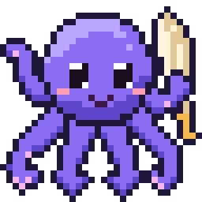

# oglyph



Native Odin fonts and text shaping: `oglyph/font` reads TrueType and
OpenType fonts, `oglyph/shape` shapes text with them the way HarfBuzz does,
the reference it is tested against. Core only (no C library), every read of
the font bounds-checked. MIT licensed ([LICENSE](LICENSE)).

## Packages

- **`font`**: a face's tables, the character to glyph map (cmap formats 0,
  4, 6, 12 and 13, and variation sequences), metrics, glyph outlines
  (glyf with composites, CFF and CFF2 charstrings), names (`name_string`: family, subfamily, and fvar's axis
  and instance names) and glyph names, the characters a face maps, and
  variable fonts: fvar's axes and named instances, avar (versions 1 and 2),
  gvar, HVAR and CFF2 blends; `set_variations` / `set_coords` pick a face's
  instance, and outlines, advances and shaping follow it.
- **`shape`**: OpenType shaping: Unicode properties, script runs and
  normalization from the Unicode 17.0.0 character database, HarfBuzz's
  shapers (default, Arabic, Hebrew, Thai, Hangul, Indic, Khmer, Myanmar,
  the Universal Shaping Engine) with its syllable machines, GSUB and GPOS
  lookups, the legacy `kern` table, fallback mark positioning, feature
  settings over all or part of the text, and variable fonts'
  FeatureVariations and device deltas.

## Use

Clone oglyph next to your project and build with `-collection:deps=..`
(the parent of both):

```odin
import ft "deps:oglyph/font"
import sh "deps:oglyph/shape"

face, err := ft.load(font_bytes)  // the bytes are borrowed
layout: sh.Layout                 // the face's tables, prepared once
sh.layout_init(&layout, &face)
plan: sh.Plan                     // per script, direction, language, features
sh.plan_init(&plan, &layout, &face, .Latin, .LTR)
shaper: sh.Shaper                 // the glyph buffer, kept warm
sh.shaper_init(&shaper)
glyphs: [dynamic]sh.Glyph
sh.shape(&shaper, &plan, &face, text_runes, nil, &glyphs)  // visual order
```

Three owners, three lifetimes: a `Layout` per face (read-only while
shaping), a `Plan` per script, direction, language and set of features,
and a `Shaper` per shaping call at a time (a warm shaper allocates
nothing). `sh.script_runs` gives each character's script for splitting
text into runs; bidi and line breaking are the caller's. A plan is for the
face's instance as it is when made: after `ft.set_variations`, plan again.

## How it shapes

A face's `Layout` prepares its tables once: lookups and subtables, the
coverages and class definitions read for every glyph unpacked into flat
arrays (a bit or a class per glyph, at most as many bytes as the tables
hold), and its cmap as a two-level table built from its spans. Each `Plan`
holds, per table, which of its lookups can start at each glyph (a two-level
table over all glyph ids, built from the coverages' spans: edges counted,
sorted in two counting passes, blocks counted then filled). A shaping call
turns that into a bitset of positions per lookup: a stage visits only the
lookups some glyph can start at, a lookup only its positions; a
substitution in place moves its position's bits, a pass that moves rows
finds them again.

## Checked against HarfBuzz

`tools/shape_corpus` compares glyphs, clusters, advances and offsets with
the system libharfbuzz (14.6, its OpenType shaper). At v0.0.1: 0
differences over its 1,043 curated cases, 27,118 feature-set cases, 24,400
random strings and 384 variable-instance cases on the installed fonts it
picks, and 51,600 random strings over 40 downloaded fonts (Google and SIL
fonts for Arabic, Indic, Myanmar, Khmer, Korean and more). Before the
fixes and speed work that went into v0.0.1, an independent verification
run of 1.45 million random strings over 38 scripts (158 script / face
pairs) agreed on every glyph and cluster (the differences it found in its
edge-case jobs are fixed in v0.0.1), and outlines at variable instances
agreed with an unrounded fontTools oracle within 0.001 units over 2.4
million glyph instances. Known differences: Arabic fonts
without GSUB are not shaped from presentation forms (HarfBuzz's fallback),
Mongolian variation selectors in text shaped as Arabic, and gvar advances
within about 0.0001 of a half unit, summed exactly where HarfBuzz rounds in
single precision.

Where HarfBuzz's own choice is worse for whoever reads the output, oglyph
departs from it on purpose, and the corpus compares what those choices
leave the same. A pair in the legacy `kern` table adds its whole value to
the left glyph's advance, as a GPOS pair adjustment does (HarfBuzz gives
the left glyph half, and the right one the other half as both advance
and offset), so a glyph is drawn at its pen and summing advances gives
pens for carets and truncation. Glyphs land at the same positions
(the corpus's pen positions: 0 differences); the raw advances and
offsets differ in 13 of the curated cases and 49 of the random ones.

### Following HarfBuzz, to review

What oglyph takes from HarfBuzz's choices rather than from a spec, each a
candidate for a departure like the one above; the code marks them "to
review" where they are.

- Behaviour: a narrow space the font lacks takes half a space, where
  Unicode suggests about a fifth of an em (`adjust_spaces`, shape.odin);
  a default ignorable loses its advance and x offset but keeps its y
  offset and attachment (`position`); a kern table with a state machine
  subtable keeps marks' advances (`kern_has_state_machine`); a lookup
  naming a mark filtering set GDEF lacks loses the flag (layout.odin);
  features get HarfBuzz's mask bits and are dropped where it drops them
  (plan.odin); an Arabic stretch makes at most 256 glyphs (arabic.odin);
  a run whose script goes the other way is shaped in the script's
  direction (`native_direction`); an invisible SHY or ZWSP doesn't take a
  letter's marks for fallback positioning (fallback.odin).
- Arithmetic, for the same rounding: variation coordinates in 16.16 and
  2.14, rounded half away from zero (var.odin), gvar's interpolation of
  untouched points (gvar.odin), CFF positions in f64 (cff.odin).
- Designs fonts are made against, to change only with fonts' evidence:
  how lookups apply and track ligatures' marks (apply.odin),
  normalization (normalize.odin), fallback mark positioning
  (fallback.odin), Indic shaping's Uniscribe compatibility (indic.odin),
  the reordered combining classes (unicode.odin).

Time against HarfBuzz, both in one process taking turns (Noto Sans, Noto
Naskh Arabic, Noto Sans Devanagari; 12 sentences, their words and 200
random strings each; `-o:speed`, one core of a Ryzen 9 9900X3D that was
busy with other work, so within a few percent): sentences 0.99-1.10x its
time (Latin 1.00x, Arabic 1.06-1.10x, Devanagari 0.99-1.04x), words and
random strings 0.66-0.90x (Devanagari words 1.02-1.03x).

## Untrusted fonts

Every read checks its bounds: a corrupt or truncated font gives wrong
glyphs or a load error, never a read out of bounds. Work is bounded by the
font's own data (a variation table over another number of axes than fvar's
is ignored, as the spec requires; preparing a plan does work in proportion
to its tables) and shaping by HarfBuzz's limits on buffer growth and lookup
steps per character. The tests mutate the layout and variation tables of
real fonts and shape and draw them with bounds checks on.

## Test

```sh
odin test font -vet -strict-style
odin test shape -vet -strict-style
odin run tools/shape_corpus -o:speed -- -quiet       # against the system libharfbuzz
odin run tools/shape_corpus -o:speed -- -random:200 -quiet
perl tools/shape_unicode/gen.pl HARFBUZZ/src > shape/unicode_data.odin        # HarfBuzz 14.6.0's source
perl tools/shape_unicode/gen_syllables.pl HARFBUZZ/src > shape/syllable_data.odin
```

Some shape tests read installed fonts (Adwaita Sans for variable fonts) and
skip without them. `assets/` holds the test fonts: Bitstream Vera Sans,
JetBrains Mono and Noto Sans Arabic Bold.

The mascot, an octopus with a quill (ink, and arms that curl like a
script's strokes), is drawn by `tools/mascot` (`odin run tools/mascot --
assets`): `assets/logo.svg` keeps its eyes, mouths and a drop of ink at the
nib (forming, falling, splashed) as layers a script can switch by id, each
colour one traced path, plus a hidden `silhouette` (the whole octopus as
one outline).

## License

MIT, see [LICENSE](LICENSE). Third-party notices are in
[THIRD_PARTY_NOTICES.md](THIRD_PARTY_NOTICES.md).
